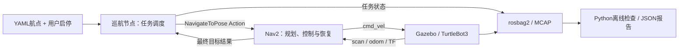
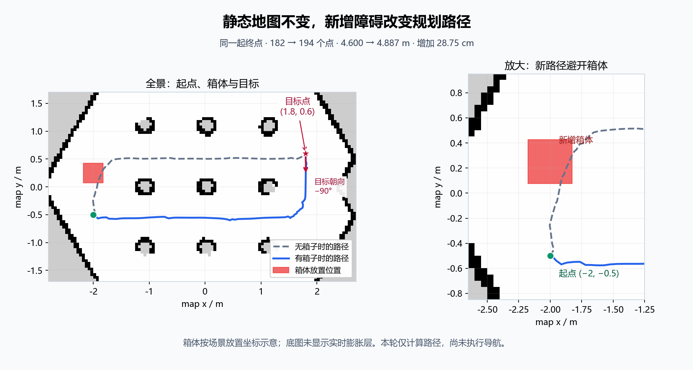

# Jeff Navi Bot

基于 **ROS 2 Humble、TurtleBot3、Gazebo和Nav2** 的移动机器人仿真项目，包含可配置多点巡航、
SLAM建图与地图重载导航，以及rosbag2/MCAP运行数据检查。

本仓库从[Jeff Follow Bot](https://github.com/coollooc3/Jeff_follow_bot)的实际工作树中提取导航相关内容，
保留原功能包名称。视觉跟随与LEAP实车接入继续在原工程维护；运行本仓库的仿真无需小车、相机或热点。

## 功能与结构

| 功能包 | 用途 | 当前主要入口 |
| --- | --- | --- |
| [`leap_nav_demo`](leap_nav_demo/README.md) | Gazebo/Nav2会话、单目标与路径请求、RPP配置 | `run_manual`、`nav_task` |
| [`leap_patrol`](leap_patrol/README.md) | 多点任务调度、开始/取消、状态报告 | `patrol.launch.py` |
| [`leap_mapping`](leap_mapping/README.md) | SLAM Toolbox建图、地图保存及AMCL重定位导航 | `mapping.launch.py`、`navigation.launch.py` |
| [`leap_localization_lab`](leap_localization_lab/README.md) | 编码器里程计实验、离线数据统计与巡航预期校验 | `exercises/bag_check.py` |



巡航按配置路线执行一轮：上一点最终`SUCCEEDED`才发送下一点；最终失败则终止整轮并保留失败点。
取消时同时阻止后续目标、请求Nav2取消当前目标。巡航节点不直接发布速度。
定位、路径搜索、控制、局部碰撞检查和恢复复用Nav2，不是本项目自研的导航算法。

`leap_nav_demo`保留早期场景与行为克隆学习脚本以维持原包依赖；当前项目主线使用上述入口，
不需要训练模型。`exercises/`中的算法练习也不替换实际Nav2插件。

## 已有验证

| 项目 | 已有证据 |
| --- | --- |
| 顺序与取消 | A→B→C、途中取消、B→A→C三项人工仿真演示 |
| 自建地图 | SLAM建图、保存与重载、AMCL初始化及地图上的巡航 |
| 路线扩展 | 通过YAML扩展到A→B→C→D，最终状态为4/4完成 |
| 失败停止 | 第二点位于地图外时，Nav2返回ABORTED，巡航FAILED且不再执行后续点 |
| 新增静止障碍 | 激光与costmap观测箱体，重新请求规划并完成绕行导航 |
| 数据检查 | 正常/取消MCAP录放，话题统计、缺失检查、最后终态与预期结果校验 |

验证记录见[巡航验证](leap_patrol/VALIDATION.md)、[建图记录](docs/mapping-status.md)和
[预期终态离线检查](docs/evidence/patrol-expectation-20261031.json)。
已有路径保存后绘制的对照图如下：这是离线结果可视化，不是RViz运行截图。



本轮障碍证据主要来自导航开始前加入的静止箱体，不包含移动障碍预测验证。
额外原地旋转的原因仍未确认；没有宣称已修复Nav2算法bug、完成实车自主导航或得到长期成功率。

## 环境与构建

已有验证环境：Ubuntu 22.04、ROS 2 Humble、Gazebo Classic 11；原开发环境的
TurtleBot3 Gazebo为2.3.8、gazebo_ros为3.9.0。机器人模型、世界与基础Nav2资源来自系统安装包。

在已经安装ROS 2 Humble、colcon和rosdep的Ubuntu环境中，安装主要运行及工具依赖：

```bash
source /opt/ros/humble/setup.bash
sudo apt update
sudo apt install \
  ros-humble-turtlebot3-gazebo ros-humble-turtlebot3-navigation2 \
  ros-humble-navigation2 ros-humble-nav2-bringup \
  ros-humble-nav2-regulated-pure-pursuit-controller \
  ros-humble-slam-toolbox ros-humble-teleop-twist-keyboard \
  ros-humble-rosbag2 ros-humble-rosbag2-storage-mcap \
  python3-yaml python3-numpy

mkdir -p ~/jeff_navi_ws/src
cd ~/jeff_navi_ws/src
git clone https://github.com/coollooc3/Jeff_Navi_bot.git
cd ~/jeff_navi_ws
rosdep install --from-paths src --ignore-src --rosdistro humble -r -y
colcon build --symlink-install
source install/setup.bash
```

新仓库沿用包名，建议使用独立工作空间，避免同时发现原工程中的同名包。
包内历史说明中的`~/xuegeros_ws/src/<包名>`对应原开发路径；在本仓库中源码位于
`~/jeff_navi_ws/src/Jeff_Navi_bot/<包名>`。本页命令使用独立工作空间。

## 首次运行巡航

每个终端先执行：

```bash
source /opt/ros/humble/setup.bash
source ~/jeff_navi_ws/install/setup.bash
export ROS_DOMAIN_ID=178 ROS_LOCALHOST_ONLY=1
```

终端A启动仿真与Nav2，等待`READY:`：

```bash
ros2 run leap_nav_demo run_manual --gui
```

终端B启动巡航节点，默认保持IDLE：

```bash
ros2 launch leap_patrol patrol.launch.py
```

终端C开始、查询或取消：

```bash
ros2 service call /patrol/start std_srvs/srv/Trigger '{}'
ros2 topic echo /patrol/status --once --full-length
ros2 service call /patrol/cancel std_srvs/srv/Trigger '{}'
```

启动服务成功只表示请求被接收。观察最终`COMPLETED / CANCELED / FAILED`、当前点、完成点数、
失败原因和`goal_unresolved`；状态字段不单独证明实际停车。
运行中或取消中重复开始会被拒绝；完成、取消或失败后再次开始，按当前路线从第一个点重新执行。
不要同时使用其他客户端下发导航目标。退出时先取消巡航，结束终端B，再结束终端A。

## 修改路线与自建地图

默认路线在`leap_patrol/config/route.yaml`。在VS Code中编辑点名和`map`坐标`x/y/yaw`，
重启巡航节点加载。示例四点路线：

```bash
ros2 launch leap_patrol patrol.launch.py \
  route_file:="$(ros2 pkg prefix --share leap_mapping)/config/patrol_route_abcd.yaml"
```

建图与已有地图导航分别使用以下入口，先退出旧仿真会话：

```bash
# 建图，随后在另一个终端使用键盘探索并保存地图。
ros2 launch leap_mapping mapping.launch.py

# 退出建图后，重载仓库内已保存的地图；在RViz设置初始位姿。
ros2 launch leap_mapping navigation.launch.py
```

地图保存、初始位姿和路线切换的完整流程见[建图说明](leap_mapping/README.md)。
建图时由SLAM提供map→odom，已有地图定位时由AMCL提供，两套入口分开运行。

## MCAP记录与结果检查

仿真会话运行时，可在另一个已加载环境的终端记录任务数据；输出目录使用时间戳避免覆盖：

```bash
mkdir -p ~/leap_nav_data/recordings
ros2 bag record -s mcap --use-sim-time \
  -o "$HOME/leap_nav_data/recordings/patrol_$(date +%Y%m%dT%H%M%S)" \
  /clock /map /scan /odom /tf /tf_static /cmd_vel /patrol/status /amcl_pose
```

任务完成后结束录制。将下面`<记录目录>`替换为实际bag目录：

```bash
python3 ~/jeff_navi_ws/src/Jeff_Navi_bot/leap_localization_lab/exercises/bag_check.py \
  <记录目录> --expect-state COMPLETED \
  --require /clock /map /scan /odom /tf /tf_static /cmd_vel /patrol/status /amcl_pose \
  --output ~/leap_nav_data/reports/patrol_checked.json
echo $?
```

`--expect-state`支持COMPLETED、CANCELED、FAILED，自动读取最后一条巡航状态。
校验状态是否与预期相符、目标是否已解除，以及COMPLETED点数是否一致。
退出0表示所请求的检查通过，1表示读取/校验失败，2表示参数或小例子检查错误。
预期FAILED且记录符合也可以退出0，不应将工具退出码直接当作导航成功。

历史原始MCAP保存在本地，仓库只带小体积结果和来源哈希。已有状态检查bag没有录`/plan`与costmap；
若要诊断路径，需要额外录对应话题。工具只检查实际录下的数据，不证明源数据新鲜度或物理停车。

## 离线学习与检查

以下不创建ROS节点、不启动仿真。在安装NumPy和PyYAML的Python环境中可运行：

```bash
cd ~/jeff_navi_ws/src/Jeff_Navi_bot/leap_patrol
python3 -m unittest discover -s test -v
python3 -m leap_patrol.exercise_check

cd ../leap_localization_lab
python3 -B -m unittest discover -s test -p test_bag_check.py -v
python3 exercises/bag_check.py --check
python3 exercises/bag_check.py --check-required
python3 exercises/bag_check.py --check-patrol
```

其他Nav2场景测试中有ROS或Linux依赖，应在Ubuntu工作空间中运行。历史验证与本次提取检查分开记录。
本次提取的文件一致性、语法/配置/链接检查及Windows离线测试范围见
[独立仓库检查报告](docs/evidence/repository-import-checks.json)。报告明确记录了缺少ROS消息包而未能通过的
接口测试尝试，以及一项缺少lxml而跳过的检查；本次没有重新执行Ubuntu构建或Gazebo导航。

## 来源、贡献与许可

项目在成熟机器人组件上做集成与应用开发。本人在提示下补全巡航最终结果处理、数据统计、
必需话题检查和终态解析，完成路线修改、仿真操作与结果核对；通信框架、部分工具及测试有AI辅助。
规划器、控制器与SLAM算法复用上游实现。

本次提取保留原有代码行为，不携带构建目录、原始bag或LEAP设备凭据。
来源与逐文件哈希见[导入清单](docs/import-manifest.json)，许可与上游来源见[NOTICE](NOTICE.md)及[LICENSE](LICENSE)。
